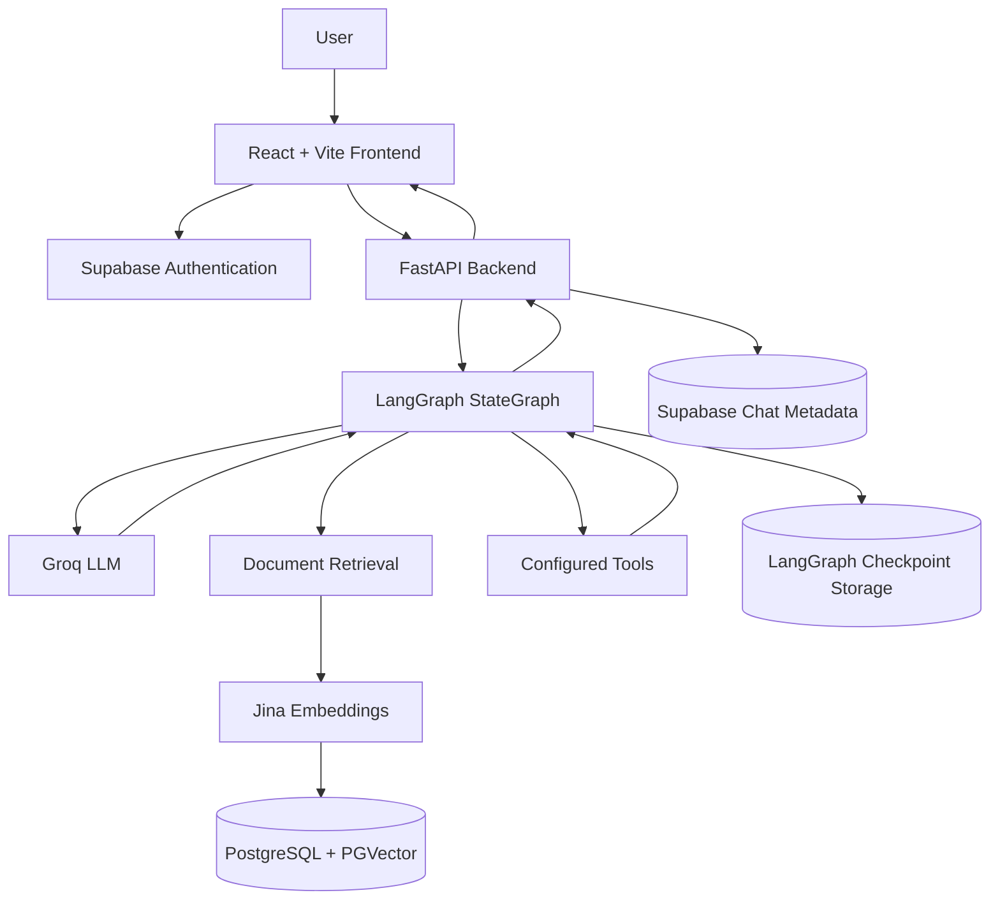
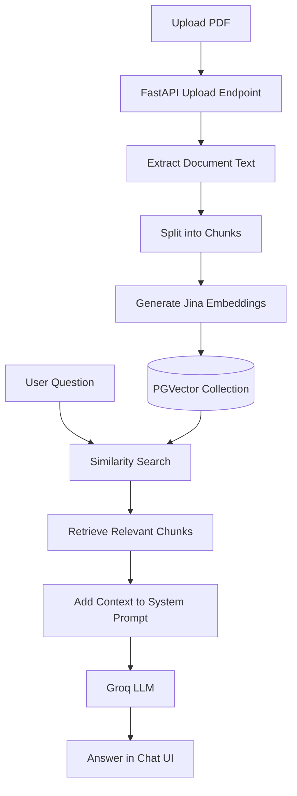

# 🧠 MultiMind — Multi-Utility AI Chatbot

<p align="center">
  <b>One AI workspace. Multiple capabilities. A single conversational interface.</b>
</p>

<p align="center">
  <a href="https://multi-mind-steel.vercel.app/">Live Application</a> •
  <a href="https://multimind-x5eq.onrender.com/docs">API Documentation</a> •
  <a href="https://github.com/Garvitpujari/MultiMind">GitHub Repository</a>
</p>

---

## 📌 Overview

**MultiMind** is a full-stack, LLM-powered chatbot designed to bring conversational AI, document understanding, semantic retrieval, and tool-based assistance into one workspace.

Instead of building separate applications for asking questions, analyzing PDFs, and interacting with AI tools, MultiMind provides a unified interface backed by a Python API and a LangGraph-powered conversational workflow.

The application combines a React frontend, FastAPI backend, Groq-hosted language model, Jina embeddings, PostgreSQL with PGVector, and Supabase Authentication.

### 🎯 Problem Statement

AI assistants become less useful when conversations, uploaded documents, and external tools are disconnected. Document-based questions also require retrieving relevant source material rather than relying entirely on the model's general knowledge.

MultiMind addresses these challenges by combining conversational interaction, document retrieval, and tool integration in a single application.

### 💡 Key Objectives

- Build a responsive, chat-based AI workspace.
- Maintain separate conversations using thread-based state management.
- Enable users to upload PDFs and ask questions about their contents.
- Retrieve semantically relevant document chunks using vector search.
- Integrate AI tools into a conversational workflow.
- Provide user authentication and a deployable frontend/backend architecture.

## ✨ Features

### 💬 Conversational AI

- Chat with a language model through a web interface.
- Manage multiple conversation threads.
- Maintain conversation state through LangGraph checkpointing.
- Display assistant responses in the conversation interface.

### 📄 PDF Question Answering

- Upload PDF documents through the chat interface.
- Extract and split document text into chunks.
- Generate embeddings using Jina.
- Store document vectors and metadata in PGVector.
- Retrieve relevant passages for document-related questions.
- Pass retrieved context to the LLM to generate grounded answers.

### 🔎 Semantic Retrieval

Traditional keyword matching can miss relevant passages when a question uses different wording from a document. MultiMind uses vector embeddings and similarity search to retrieve semantically related content.

Document metadata, including the conversation's `thread_id`, is used to scope retrieval to the relevant conversation.

### 🛠️ Tool-Enabled AI

The LangGraph/LangChain ecosystem supports tool calling and extensible workflows. MultiMind's backend is designed to connect the language model with configured tools, allowing capabilities to be expanded without rebuilding the entire interface.

Only integrations configured in the current backend should be considered active.

### 🔐 Authentication

- Supabase Authentication for account creation and login.
- Session-aware frontend UI.
- Backend integration with Supabase for identity validation and chat metadata.

**Security status:** Complete authentication enforcement and per-user ownership checks across all backend endpoints remain work in progress.

---

## 🏗️ System Architecture



### Architecture Components

| Layer | Technology | Responsibility |
|---|---|---|
| Presentation | React, Vite, CSS | Chat interface, sidebar, authentication UI, PDF upload |
| API | FastAPI | Handles frontend requests and backend operations |
| Orchestration | LangGraph | Manages conversation state and model/tool workflow |
| Language model | Groq API | Generates conversational responses |
| Embeddings | Jina Embeddings | Converts document chunks and queries into vectors |
| Vector storage | PostgreSQL, PGVector | Stores and retrieves document embeddings |
| Authentication | Supabase Auth | Handles user identity and sessions |
| Chat metadata | Supabase PostgreSQL | Intended source for saved chat titles, owners, and timestamps |
| Checkpointing | LangGraph checkpointer | Persists conversation state according to its configuration |
| Deployment | Vercel, Render | Hosts the frontend and backend separately |

> **Note:** Chat metadata persistence and checkpoint storage are separate responsibilities. The exact checkpoint backend and metadata synchronization should be verified against the current configuration.

---

## 🔄 How MultiMind Works

### 1. Normal Chat

1. The user enters a message in the React interface.
2. The frontend sends the message and conversation `thread_id` to FastAPI.
3. LangGraph processes the conversation state.
4. The configured language model generates a response.
5. The backend returns the response to the frontend.
6. The interface displays the answer in the active conversation.

### 2. PDF Ingestion and Question Answering



The current vector collection is configured as:

`multimind_documents_jina_768`

The `768` suffix corresponds to the configured embedding dimension. The embedding model and collection must remain consistent for document ingestion and query-time retrieval.

### 3. Conversation Persistence

LangGraph checkpointing maintains conversational state using a `thread_id`. This allows conversations to be distinguished from one another.

Supabase's `user_chats` table is intended to store the associated user ID, thread ID, title, and creation timestamp. The metadata mapping and ownership enforcement still need to be completed and verified.

---

## 🧰 Technology Stack

| Technology | Why it is used |
|---|---|
| React | Component-based frontend |
| Vite | Frontend development and build tooling |
| CSS | Layout, responsive styling, and visual design |
| Python | Backend implementation |
| FastAPI | REST API and request handling |
| LangChain | LLM integrations and retrieval components |
| LangGraph | Stateful conversational workflow |
| Groq | Hosted language-model inference |
| Jina Embeddings | Semantic vector representations |
| PostgreSQL | Relational data storage |
| PGVector | Vector similarity search |
| Supabase | Authentication and chat metadata services |
| Vercel | Frontend deployment |
| Render | Backend deployment |
| Git and GitHub | Version control and source hosting |

---

## 🚀 Live Links

| Resource | Link |
|---|---|
| Live application | [multi-mind-steel.vercel.app](https://multi-mind-steel.vercel.app/) |
| Backend service | [multimind-x5eq.onrender.com](https://multimind-x5eq.onrender.com) |
| Interactive API docs | [Swagger UI](https://multimind-x5eq.onrender.com/docs) |
| Source code | [GitHub Repository](https://github.com/Garvitpujari/MultiMind) |

The deployed application depends on the availability and configuration of its external services and credentials.

---

## ⚙️ Local Installation

### Prerequisites

- Python 3.10 or newer
- Node.js and npm
- Git
- Groq API key
- Jina API key
- Supabase project credentials
- PostgreSQL database with PGVector enabled

### 1. Clone the repository

```bash
git clone https://github.com/Garvitpujari/MultiMind.git
cd MultiMind
```

### 2. Set up the backend

```bash
cd backend
python -m venv venv
```

Activate the virtual environment on Windows:

```powershell
venv\Scripts\activate
```

Install dependencies:

```bash
pip install -r requirements.txt
```

Create a `backend/.env` file:

```env
GROQ_API_KEY=your_groq_api_key
JINA_API_KEY=your_jina_api_key
DATABASE_URL=your_postgresql_connection_string
SUPABASE_URL=your_supabase_project_url
SUPABASE_SECRET_KEY=your_supabase_secret_key
```

Use the exact variable names expected by your current code. Additional variables may be required by configured tools or checkpoint storage.

Start the backend:

```bash
uvicorn main:app --reload
```

API documentation:

`http://127.0.0.1:8000/docs`

### 3. Set up the frontend

Open a second terminal:

```bash
cd frontend
npm install
```

Create a `frontend/.env` file:

```env
VITE_API_BASE_URL=http://127.0.0.1:8000
```

Configure the Supabase project URL and public/publishable key using the names expected by `frontend/src/library/supabase`.

Start the frontend:

```bash
npm run dev
```

Open the local URL shown in the terminal.

### 🔑 Environment Variable Security

- Never commit `.env` files.
- Keep Groq, Jina, database, and Supabase secret/service-role keys on the backend.
- Frontend variables prefixed with `VITE_` are exposed to browser code. Never put private credentials in them.
- Configure CORS to allow only the intended frontend origins in production.

---

## 🧩 Challenges Faced and Lessons Learned

Developing MultiMind involved debugging issues across the AI workflow, retrieval pipeline, frontend/backend integration, and deployment.

### 1. LangGraph State and Node Configuration

**Challenge:** Managing state across multiple conversations while keeping graph nodes, state schemas, and model calls consistent.

**Issues encountered:**
- Graph inspection errors when attempting to call graph methods on the wrong object.
- State and configuration handling across graph nodes.
- Ensuring the correct `thread_id` is passed to model execution and checkpointing.

**Lesson learned:** LangGraph's graph definition, compiled graph, state schema, and checkpoint configuration have distinct responsibilities. They must be wired together correctly.

### 2. Prompt Initialization and Runtime Errors

**Challenge:** A chat request failed with an `UnboundLocalError` because `system_prompt` was not guaranteed to be initialized before the retrieval error-handling flow.

**Resolution:** The prompt was initialized before the retrieval block, allowing the request to proceed with a defined prompt even if retrieval fails.

**Lesson learned:** Initialize required variables before conditional execution and handle retrieval failures separately from model invocation.

### 3. Building the PDF RAG Pipeline

**Challenge:** Turning long PDF documents into searchable context for a language model.

**Difficulties:**
- Extracting and splitting PDF content.
- Generating vector embeddings for chunks.
- Retrieving useful passages for a particular question.
- Ensuring retrieved context is associated with the correct conversation.
- Preventing the chatbot from claiming that a PDF was retrieved when no matching passages were found.

**Approach:** We implemented document chunking, Jina embeddings, PGVector storage, similarity search, and conditional context injection into the system prompt.

**Lesson learned:** A successful upload does not guarantee a successful retrieval. The entire ingestion-to-answer pipeline must be tested.

### 4. Embedding and Vector Collection Consistency

**Challenge:** Ensuring the embedding model, vector dimensions, and database collection configuration match.

**Resolution:** The current configuration uses Jina embeddings and the `multimind_documents_jina_768` collection.

**Lesson learned:** Changing embedding models or dimensions requires careful migration and re-embedding; query vectors must be compatible with stored vectors.

### 5. Deployment and Environment Variables

**Challenge:** Running a React frontend and Python backend as separate deployed services.

**Difficulties:**
- Setting the correct API base URL.
- Configuring CORS.
- Managing credentials separately between local development and deployment.
- Debugging requests through deployment logs and Swagger UI.

**Approach:** The frontend is deployed on Vercel and the FastAPI backend on Render, with service configuration supplied through environment variables.

### 6. Authentication Versus Authorization

**Challenge:** Connecting Supabase login with backend chat and document operations.

**Key distinction:**
- **Authentication** determines who the user is.
- **Authorization** determines which conversations and documents that user can access.

A valid login alone does not protect a backend endpoint. The backend must validate the identity and verify ownership before returning or modifying data.

**Status:** Per-user authorization checks across chat, PDF upload, and history endpoints remain a required improvement before production use.

### 7. Chat Titles and Ordering

**Challenge:** The sidebar shows generic titles such as `Previous conversation`.

**Root cause:** LangGraph checkpoint IDs identify conversations but do not automatically provide human-readable titles. The frontend currently uses a generic fallback when a saved title is missing.

**Planned improvement:**
- Derive a short title from the first user message.
- Persist the title and creation timestamp.
- Load titles from saved chat metadata.
- Sort conversations consistently by timestamp.
- Preserve titles and ordering after refreshes and new sessions.

### 8. UI Styling and Responsive Layout

**Challenge:** Styling the authentication form consistently within the existing modal.

**Approach:** The form styling is being separated into its own `Auth.css` stylesheet, allowing visual improvements without modifying authentication logic.

**Lesson learned:** Separating component styles makes the UI easier to maintain and reduces the risk of unintended changes to other parts of the application.

---

## 📍 Current Development Status

### Implemented

- [x] React/Vite frontend and FastAPI backend
- [x] LangGraph conversational workflow
- [x] Groq model integration
- [x] PDF upload and chunking pipeline
- [x] Jina embedding generation
- [x] PGVector similarity retrieval
- [x] Supabase Authentication integration
- [x] Frontend and backend deployment

### Remaining Improvements

- [ ] Generate meaningful titles for new conversations.
- [ ] Persist titles and timestamps in Supabase.
- [ ] Maintain reliable chronological chat-history ordering.
- [ ] Automatically close the authentication modal after successful login or signup when a session is established.
- [ ] Enforce and test per-user authorization across all relevant backend endpoints.
- [ ] Verify document and checkpoint isolation between users.
- [ ] Add end-to-end tests for chat, PDF upload, retrieval, authentication, and history restoration.

Checkboxes should be updated only after the corresponding behavior has been tested.

---

## 🔮 Future Roadmap

- AI-generated chat titles and improved history management.
- Stronger user-level data isolation.
- More useful tools and external integrations.
- Better streaming and response feedback.
- Automated backend and frontend tests.
- Improved error handling and observability.
- More polished mobile and responsive layouts.

## 👨‍💻 Author

**Garvit Pujari**

- GitHub: [Garvitpujari](https://github.com/Garvitpujari)
- Project: [MultiMind on GitHub](https://github.com/Garvitpujari/MultiMind)

---

*MultiMind — one workspace for multiple AI capabilities.*
